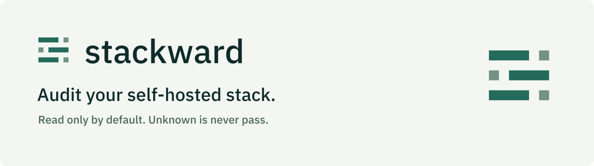
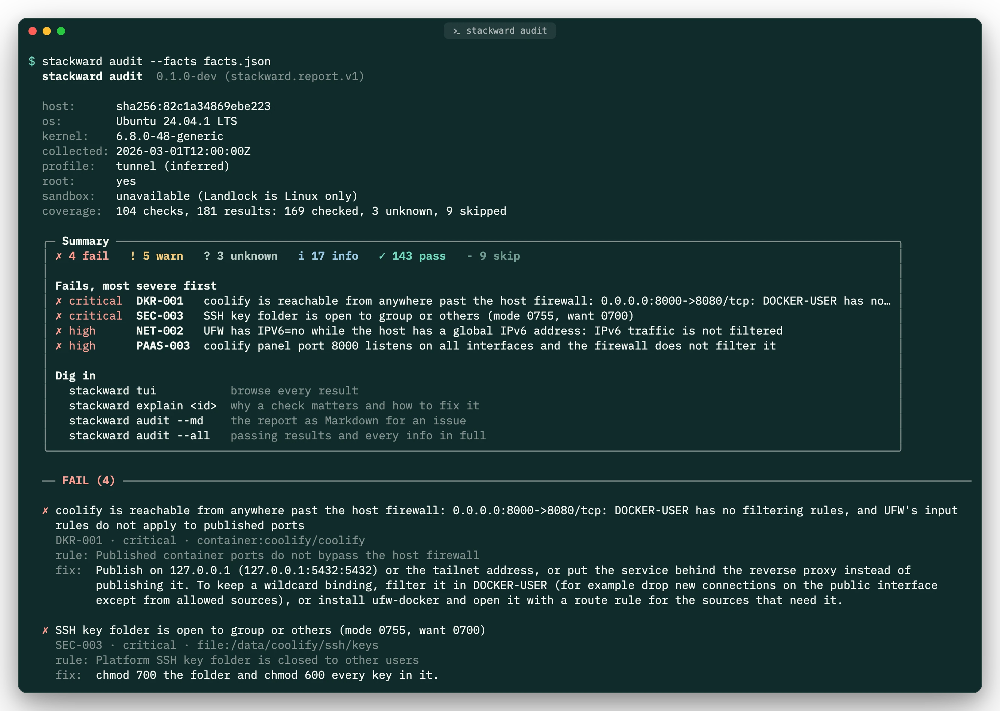
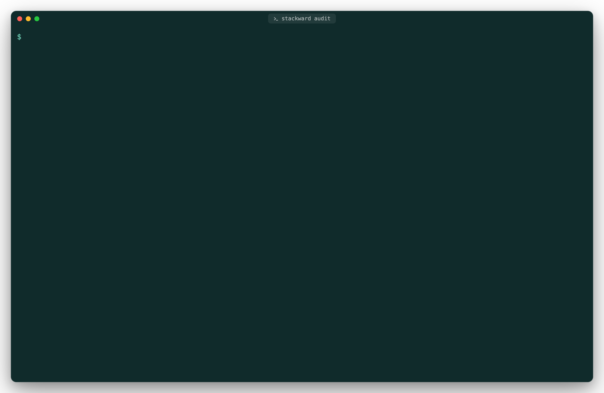
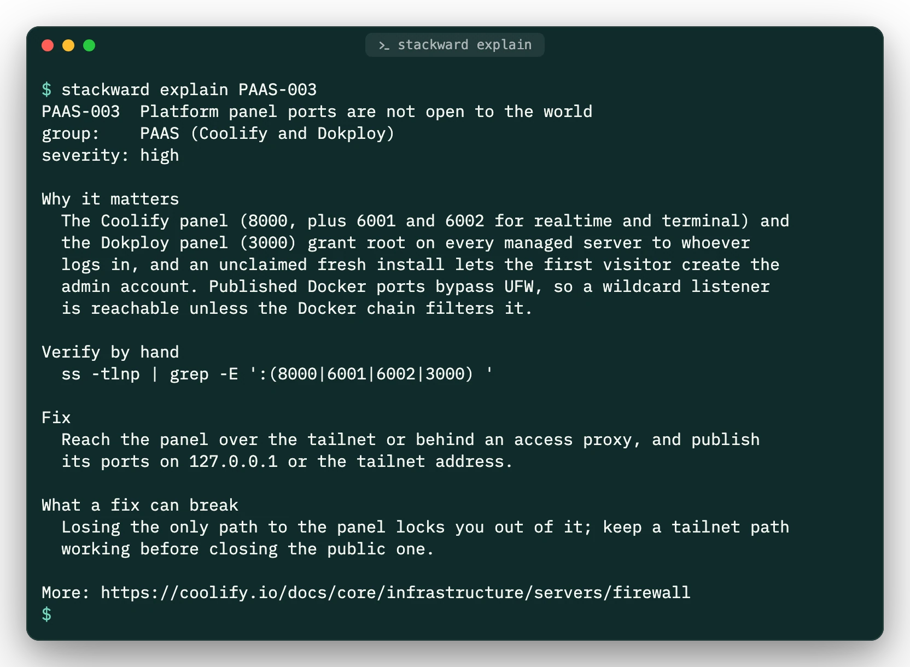
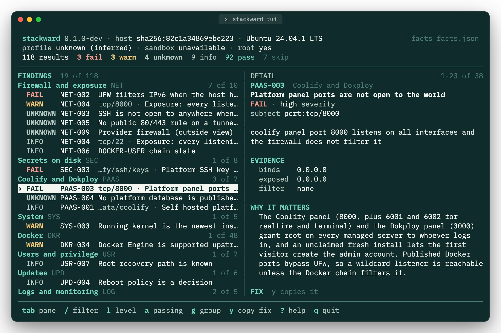

<div align="center">
  <picture>
    <source media="(prefers-color-scheme: dark)" srcset="assets/brand/readme-header-dark.svg">
    <source media="(prefers-color-scheme: light)" srcset="assets/brand/readme-header-light.svg">
    
  </picture>

  <p><strong>A read only security audit for the self hosted Linux server you actually run: Docker, a PaaS panel, a reverse proxy, a tunnel or a tailnet in front.</strong></p>

  <p>
    <a href="https://github.com/Shironex/stackward/actions/workflows/ci.yml"></a>
    <a href="https://github.com/Shironex/stackward/releases/latest"></a>
    <a href="go.mod"></a>
    <a href="LICENSE"></a>
    <a href="https://shironex.github.io/stackward/"></a>
  </p>

  <p>
    <a href="https://shironex.github.io/stackward/"><strong>Docs</strong></a>
    &nbsp;·&nbsp;
    <a href="docs/checks/index.md"><strong>Checks catalog</strong></a>
    &nbsp;·&nbsp;
    <a href="CONTRIBUTING.md"><strong>Contributing</strong></a>
    &nbsp;·&nbsp;
    <a href="SECURITY.md"><strong>Security</strong></a>
  </p>

  
  <p><sub>Real output of <code>stackward audit</code> over the saved facts in <a href="test/fixtures/showcase-coolify-tunnel">test/fixtures/showcase-coolify-tunnel</a>, rendered by <a href="assets/showcase">assets/showcase</a>.</sub></p>
</div>

Most small servers are not a bare Linux box. They run Docker under Coolify or
Dokploy, Traefik or Caddy in front, a Cloudflare Tunnel or Tailscale for the
way in, and CrowdSec or fail2ban on top. Each layer changes what is really
exposed: a published Docker port skips UFW, a panel port listens on every
interface, a backup copy in the proxy folder is loaded as live config.

stackward reads that whole stack and answers two questions: what is actually
exposed, and what is misconfigured. Every finding has a stable check id, the
evidence it saw and the fix, and anything it could not inspect is reported as
`unknown`, never as a pass.

> [!NOTE]
> **Newest: v0.3.0.** The checks below are tested against saved facts and on
> real Ubuntu hosts. `audit`, `probe`, `explain` and `tui` only read: they
> report and change nothing. Since v0.2, `plan` writes the fixes down and
> `apply` runs the steps you choose, with backups, a journal and `undo`.
> Read the report before acting on it, and see the
> [known limits](CHANGELOG.md).

## A run, start to finish

<p align="center">
  
</p>

## What it checks

112 audit checks in 15 groups and 6 outside view checks today, each with its own page in the
[checks catalog](docs/checks/index.md):

| Group | Checks | What it looks at |
|---|---:|---|
| `SYS` System | 5 | Tested distribution, pending reboot, running kernel, clock sync, disk space |
| `SSH` SSH | 16 | The effective config from `sshd -T`: password and root login, drop-in order, where sshd listens, host and authorized keys, weak algorithms |
| `USR` Users and privilege | 7 | Extra uid 0 accounts, empty passwords, the cloud default account, sudoers, docker group members, unused logins |
| `NET` Firewall and exposure | 9 | UFW defaults and IPv6, every listening socket and who can reach it, `DOCKER-USER`, ufw-docker |
| `PFW` Provider firewall | 8 | Opt in with `--provider` and a read only token: the cloud provider's firewall is attached, default deny, no open UDP or SSH to anywhere, no stale rules, IPv6 covered, return traffic on a stateless firewall ([guide](docs/provider-firewall.md)) |
| `DKR` Docker | 16 | API on TCP, socket mounts and socket proxies, sensitive mounts, root and privileged containers, capabilities, shared networks, log rotation, pinned images, engine support |
| `UPD` Updates | 6 | Automatic security updates, the security pocket, pending security updates, release support, reboot policy |
| `KRN` Kernel settings | 5 | Forwarding and reverse path filter where Docker runs, network and kernel hardening sysctls, IPv6 router advertisements |
| `LOG` Logs and monitoring | 5 | Journal size cap and persistence, proxy log rotation, a metrics agent |
| `SEC` Secrets on disk | 7 | Permissions, never contents: platform `.env` files, the platform SSH key folder, private keys, Docker client config, the proxy dynamic folder |
| `PAAS` Coolify and Dokploy | 6 | Platform detection, proxy and panel ports, published platform databases, Swarm ports |
| `BAK` Backups | 2 | Platform database backups on the host, backup tools present |
| `TS` Tailscale | 5 | Logged in and running, node key expiry, Funnel and Serve exposure, firewall rules that name `tailscale0`, Tailnet Lock |
| `CF` Cloudflare Tunnel | 5 | Tunnel presence and connectors, proxy not reachable on a public address, token not on the command line, origin not answering from outside |
| `CS` CrowdSec and fail2ban | 10 | CrowdSec running, bouncers pulling decisions, L7 bouncer behind a tunnel, whitelists, proxy log acquisition, local API bind, public SSH brute force protection |
| `PRB` Outside view | 6 | Run by `stackward probe` from another machine: public SSH, web ports on the raw IP, Docker API, panels and dashboards, databases, the app hostname over HTTPS |

The PRB checks run in `stackward probe`, not in `audit`.

## The read only promise

`audit`, `probe`, `explain`, `tui` and `schedule` only read. `plan` changes nothing either;
`apply`, `undo` and `confirm` are the only commands that change a system (see
[docs/apply.md](docs/apply.md)). The audit:

- writes no file except the report you ask for with `--out` (and the
  Prometheus metric you ask for with `--textfile`);
- confines itself with a Landlock sandbox where the kernel supports it
  (Linux 5.13+): no file writes, and no TCP connections on Linux 6.7+. The
  report header says whether the sandbox was applied;
- talks to Docker over its Unix socket with GET requests only;
- never runs a command that changes state;
- never reads the contents of secret files, only their permissions;
- redacts secret shaped values from everything it prints or dumps, and
  hashes the hostname unless you pass `--show-hostname`;
- sends nothing anywhere. No telemetry, ever. The one opt in exception is
  `--provider`, which reads your cloud provider's firewall with GET requests
  to its API host only, using a read only token from the environment or a
  file ([docs/provider-firewall.md](docs/provider-firewall.md)).

What it reads, what it never does and what it does not cover:
[docs/threat-model.md](docs/threat-model.md).

## Install

The newest release is [`v0.3.0`](https://github.com/Shironex/stackward/releases/latest).
Every release holds Linux archives for amd64 and arm64,
archives for macOS and Windows (for `probe`), a `.deb`, an SPDX SBOM per
archive, `checksums.txt` signed keylessly with cosign, GitHub build
provenance, `install.sh` and `get.sh`.

A step by step guide is on the [install page](docs/install.md): which method to
pick, the `.deb` for amd64 and arm64, checking the download, the first run, and
upgrading or removing each method. The shortest safe path is below.

The guided way is `install.sh`: install, update and uninstall with a step by
step display, a checksum check before anything is written, and `apt` on
Debian and Ubuntu. Download it, read it, run it:

```sh
curl -fsSLO https://github.com/Shironex/stackward/releases/latest/download/install.sh
less install.sh
sudo sh install.sh
```

Once you have read it, the one-line form is
`curl -fsSL https://github.com/Shironex/stackward/releases/latest/download/install.sh | sudo sh`:
it downloads the same script from the latest release and runs it as root, and
the script checks the SHA-256 (and the cosign signature when cosign is
installed) before it installs anything. Options, `update` and `uninstall`:
[docs/install.md](docs/install.md#install-script).

To do every step by hand instead, download, check and run:

```sh
VERSION=v0.3.0
ARCH=amd64   # or arm64
BASE=https://github.com/Shironex/stackward/releases/download/$VERSION
curl -fsSLO "$BASE/stackward_${VERSION#v}_linux_$ARCH.tar.gz"
curl -fsSLO "$BASE/checksums.txt"
curl -fsSLO "$BASE/checksums.txt.sigstore.json"

# the archive matches checksums.txt
grep " stackward_${VERSION#v}_linux_$ARCH.tar.gz\$" checksums.txt | sha256sum -c -

# checksums.txt was signed by this repository's release workflow
cosign verify-blob --bundle checksums.txt.sigstore.json \
  --certificate-identity "https://github.com/Shironex/stackward/.github/workflows/release.yml@refs/tags/$VERSION" \
  --certificate-oidc-issuer https://token.actions.githubusercontent.com \
  checksums.txt

# or: GitHub build provenance for the archive
gh attestation verify "stackward_${VERSION#v}_linux_$ARCH.tar.gz" --repo Shironex/stackward

tar -xzf "stackward_${VERSION#v}_linux_$ARCH.tar.gz" stackward
sudo ./stackward audit
```

`get.sh` does the download and the SHA-256 check for you, and the cosign
check when cosign is installed. It never runs the binary and never uses
sudo; read it first:

```sh
curl -fsSLO https://github.com/Shironex/stackward/releases/latest/download/get.sh
less get.sh
sh get.sh -d "$HOME/.local/bin"
# a specific release: sh get.sh -v v0.1.0 -d "$HOME/.local/bin"
```

Or build from source with Go 1.26 or later. Keep `CGO_ENABLED=0`:
the Landlock sandbox needs a cgo free binary.

```sh
git clone https://github.com/Shironex/stackward && cd stackward
CGO_ENABLED=0 go build -trimpath -o stackward ./cmd/stackward
```

Every option, the `.deb` and reproducible builds:
[docs/install.md](docs/install.md).

## Usage

```
stackward audit [--json | --md] [--out FILE] [--fail-on fail|warn|never] [--all]
stackward audit [--info] [--group] [--plain]
                                      text layout: info in full, by check group, no colors
stackward audit --md --out report.md  Markdown for an issue or handover note
stackward audit --dump-facts          redacted facts, for bug reports
stackward audit --facts FILE          evaluate a saved facts file
stackward audit --textfile F.prom.tmp also write a Prometheus textfile metric (rename it after the run)
stackward explain [id]                explain a check, or list them all
stackward schedule --print [-- FLAGS] print a systemd service and timer for a scheduled audit (installs nothing)
stackward tui [--report FILE | --facts FILE]
                                      browse the findings in the terminal
stackward tui --plan PLAN.json        pick plan steps in a guided list, apply what you confirm (root)
stackward probe HOST [--hostname NAME] [--ports LIST] [--profile P] [--json] [--out FILE] [--i-own-this]
stackward plan [--out FILE] [--json | --emit-script]
                                      the changes that would fix the findings, changing nothing
stackward apply [--step ID]... [--all-safe] [--confirm-within 5m] [--yes] PLAN.json
                                      apply the chosen steps with backups and a journal (root)
stackward undo --run RUN_ID           reverse an apply run from its journal (root)
stackward confirm ID                  keep an access-critical change, from a new SSH session (root)
stackward version
```

### Audit this host

```sh
sudo stackward audit                       # text report: summary, then fail, warn, unknown, info
sudo stackward audit --all                 # list passing and skipped results and every info too
sudo stackward audit --group               # results by check group instead of by level
sudo stackward audit --json --out report.json
sudo stackward audit --md --out report.md
stackward audit --profile tunnel           # auto, tunnel, public-web, tailnet-only or paas-panel
```

The text report opens with a summary box: the counts, the fails most severe
first and the commands to dig in. Each result leads with what was found, then
its check id, severity and subject, the rule it was measured against and the
fix, wrapped to the terminal width. Info results are one line each (`--info`
lists them in full). Colors, Unicode marks and the box only go to a terminal:
a pipe, an `--out` file or `--plain` gets plain ASCII, and `NO_COLOR` drops
only the colors. `COLUMNS` sets the width (100 when it is unknown).

`--profile` says how traffic is meant to reach the host, so a public 80/443
rule can be judged: fine on a public web server, a finding behind a tunnel.
`auto` infers it and reports `unknown` where it cannot tell.

Exit codes: `0` no result at or above `--fail-on` (default `fail`), `1`
findings, `2` the tool itself failed. `--fail-on warn` also counts warnings;
`unknown` never trips it. The JSON report follows
[schema/report.v1.json](schema/report.v1.json).

### Scheduled audits

```sh
stackward schedule --print -- --profile tunnel   # prints a service and a timer, writes nothing
```

stackward never installs anything, so it prints a hardened systemd service
and timer for you to install by hand. The scheduled run writes the JSON
report and a Prometheus textfile metric for node_exporter, each through a
temporary file and a rename. [docs/schedule.md](docs/schedule.md) shows how to
install and remove the units, lists the metric names and labels, and has
alerting rules to start from.

### Explain a check



`stackward explain <id>` prints why a check matters, how to verify it by
hand, how to fix it and what the fix can break. `stackward explain` alone
lists every check. The same text is in the
[checks catalog](docs/checks/index.md).

<br clear="right">

### Save facts, replay them

```sh
sudo stackward audit --dump-facts > facts.json   # redacted, hostname hashed
stackward audit --facts facts.json              # the same report, anywhere
```

Checks only see the collected facts, so a facts file reproduces a report
exactly. That is how a bug report becomes a golden test, and how the
pictures in this README are made. Read a dump before you share it: secret
shaped values are masked, but you are the last reviewer.

### Probing from outside

`audit` cannot see the provider firewall (NET-009). `probe` can: run it from
your laptop or another server against the host you own.

```sh
stackward probe 203.0.113.10 --profile tunnel --hostname app.example.com
```

It resolves the target over IPv4 and IPv6, makes plain TCP connects to a
short fixed list (SSH, 80 and 443, the Docker API, panel and dashboard
ports, databases), reads the SSH banner, asks the raw IP for `/` over HTTP
and HTTPS (the HTTPS request skips certificate verification, since an IP has
no certificate name) and, with `--hostname`, checks the app over HTTPS for
redirect loops and certificate problems. Results are the PRB checks in the
same report format as `audit`.

- **One host only.** Ranges, CIDR blocks and lists are refused. `--ports`
  adds up to 16 single ports, for example a moved SSH port.
- **Consent.** Probing a host you do not own may be illegal. probe asks for
  `y` on a terminal; in scripts pass `--i-own-this`.
- **Profile.** probe has no host facts, so `--profile auto` judges open SSH
  and web ports as if nothing should be public and says so. Pass
  `--profile tunnel`, `public-web`, `tailnet-only` or `paas-panel`.
- **Probe the origin.** If a name points at a CDN or tunnel edge, probe the
  origin IP and pass the name with `--hostname`. If `audit` on the host shows
  a tunnel and PRB-002 fails, the origin is bypassable (CF-005).
- **Run it from another machine.** A target that is loopback or one of this
  machine's own addresses is probed from the host itself, so services bound to
  loopback answer and the results do not show what the internet sees. probe
  warns on stderr before it starts, prints a `WARNING:` line in the text
  report and sets `probe.self_target` to `true` in the JSON report.
- An address family this machine cannot reach (often IPv6) is reported as
  unreachable and its ports as `unknown`, never as closed.
- probe reports name the target; read them before sharing.

### Browsing findings


<p align="center"><sub>The same saved facts, rendered on macOS, which has no Landlock: that is why the header says <code>sandbox unavailable</code>.</sub></p>

`stackward tui` runs the same audit as `stackward audit` (same flags, same
sandbox, same read only promise) and opens a findings browser: results by
group, worst first. A row shows what was found (the result message), and
the detail pane beside it shows the rule that was checked, the evidence and
the full explanation, fix and verify steps of the selected check. `--report report.json` browses a saved
`--json` report instead, `--facts facts.json` a saved facts file.

Keys: arrows or `j`/`k` move, `tab` switches between the list and the
detail pane, `/` filters, `l` cycles the level, `a` shows passing and
skipped results, `g` jumps to the next group, `y` copies the fix, `?` lists
every key, `q` quits. Copying uses the terminal clipboard sequence (OSC 52)
and only happens when you press `y`; the browser writes no file. It needs
at least 60x16 and is laid out for 80x24. `NO_COLOR` turns colors off.

Since 0.2, `sudo stackward tui --plan plan.json` opens a guided
step list over a saved plan instead: steps grouped safe, networking and
access-critical, each with what it changes, why, its diff, its undo and,
for access-critical steps, the lockout guard's proof. Nothing changes until
you confirm the review screen; then the steps run with the same code as
`stackward apply` ([docs/apply.md](docs/apply.md#the-step-list)).

### Reading a report

Every result is `pass`, `warn`, `fail`, `unknown` (could not inspect, never a
pass), `skip` (does not apply) or `info`. There is no score: read the counts
and the coverage line, which says how many results were unknown, whether root
was available and whether the sandbox was applied. Fix the highest severity
`fail` results first.

### Accepting a finding

A finding you accept on purpose (a port that is public by design, a known
sudoer) goes in a waivers file, `.stackward.yml` in the working directory or
`--waivers FILE`, with the check id, the exact subject, a reason and an
expiry date (and `level: fail` if a fail is accepted too; by default a
waiver accepts warnings only):

```yaml
version: 1
waivers:
  - check: NET-004
    subject: port:tcp/443
    reason: public web server by design
    expires: 2027-01-31
```

The finding is then shown as accepted, with its reason and expiry, and no
longer trips `--fail-on`; it is never hidden and its evidence never changes.
When the date passes it comes back at its real level, and waivers that
expired, no longer match, are too narrow for the result or run more than a
year are listed for review. Why waivers must expire and how the
file is checked: [docs/waivers.md](docs/waivers.md).

## Coverage and limits

- **Root matters.** 53 of the 112 checks need root to read what they judge
  (sshd's effective config, firewall rules, Docker, secret file
  permissions). Without root they report `unknown` with the reason, and the
  coverage line counts them. Run with `sudo` for full coverage.
- **The provider firewall is invisible from inside.** Security groups and
  cloud firewalls cannot be seen from the host; `NET-009` says so on every
  run instead of guessing. `--provider hetzner|ovh` reads a Hetzner Cloud
  Firewall or an OVH Edge Network Firewall over its API (opt in, read only
  credentials), and `stackward probe`
  from another machine shows what actually gets through.
- **A snapshot of configuration.** It does not scan your applications or
  images for vulnerabilities, does not read your cloud or Cloudflare
  account, and is not an intrusion detector.
- **Tested on** Ubuntu 22.04 and 24.04: CI runs the live scenarios there.
  Debian 12 and later is supported by design but not covered by the live
  scenarios yet. Other distributions work, with more `unknown` results;
  `SYS-001` tells you.

A report with no findings means none of these checks found a problem in what
could be inspected. It does not mean the server is secure.

## Roadmap

- **v0.1 (released):** the read only audit: the checks above, and signed
  releases.
- **v0.2 (released):** `stackward plan` and `stackward apply`, with backups
  and a rollback timer for SSH, firewall and user changes.
- **v0.3 (released):** the opt in provider firewall audit (`--provider`).
- **Next:** waivers, drift against a baseline, several hosts over
  SSH, read only API modules and more platforms.

The full plan, with a link to an issue for every item and the list of things
stackward will not do, is in [docs/roadmap.md](docs/roadmap.md). The safety
design is in [docs/safety.md](docs/safety.md).

## Contributing

Bug reports, false positives and check requests are welcome through the
[issue forms](https://github.com/Shironex/stackward/issues/new/choose). Before
adding a collector or a check, read [CONTRIBUTING.md](CONTRIBUTING.md) and
[docs/architecture.md](docs/architecture.md). Report vulnerabilities
privately as described in [SECURITY.md](SECURITY.md). Participation is
covered by the [code of conduct](CODE_OF_CONDUCT.md).

## License

[Apache License 2.0](LICENSE).
